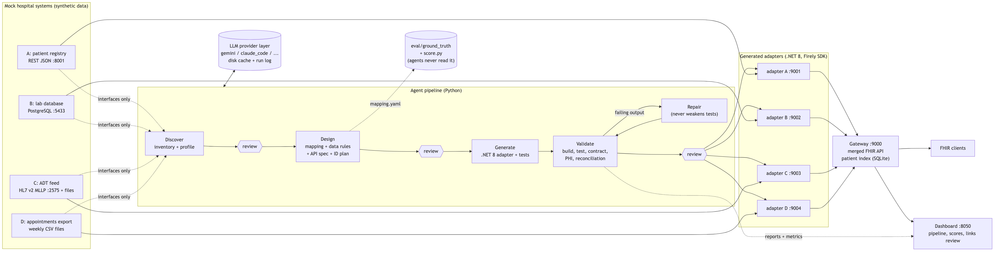
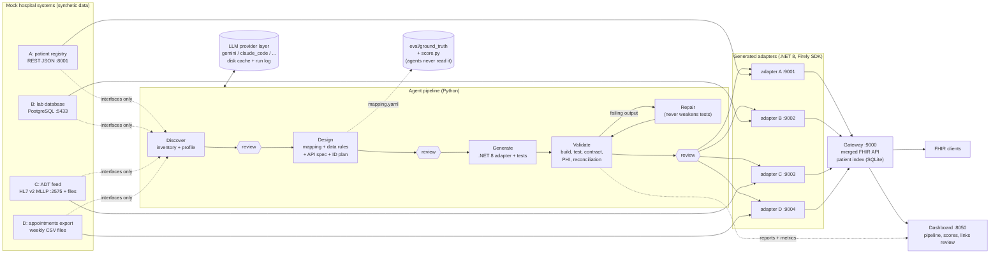

# Architecture



The Mermaid source of the picture:



## How to read it

- The **mock systems** are four messy hospital systems with synthetic data. The agents only use their interfaces: HTTP, SQL, MLLP and export files.
- The **agent pipeline** runs Discover, Design, Generate and Validate. A person approves the output at the review gates. Validate repairs the generated code in a loop, but it may never delete or weaken a test.
- Each **adapter** reads one source system and serves FHIR R4 JSON.
- The **gateway** is the single FHIR entry point. It links patients across systems by the shared hospital number. When it finds a likely match with a different id, it marks it as *probable* for review.
- The **LLM provider layer** sits behind every agent call, so the provider can change without changing the agents.
- **eval/** holds the answer key and the scorer. A test in CI makes sure the agents never open the answer key.

To make `architecture.png` again after you change the diagram (needs Node; the first run downloads mermaid-cli):

```bash
make diagram
```
